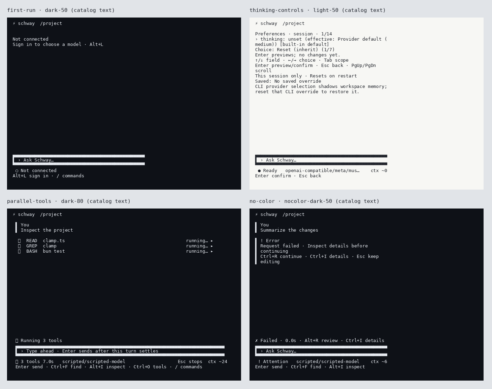

# Copy sweep verification (#148)

Baseline: `1bd7c5ef9a40c915b986f62fca112a8f62268279`. Discovery returned 80 files; the seed/discovery union contains 87. Five additional shared-format/constant files were also checked.
# Inventory

| File | Surfaces | Disposition | Strings changed |
| --- | --- | --- | --- |
| `src/agent/events.ts` | Shared error, diagnostic or message | excluded: headless --json field names and values; model-visible results | 0 |
| `src/agent/loop.ts` | Shared error, diagnostic or message | excluded: headless --json field names and values; model-visible results | 0 |
| `src/agent/retry.ts` | Shared error, diagnostic or message | excluded: headless --json field names and values; model-visible results | 0 |
| `src/agent/scheduler.ts` | Shared error, diagnostic or message | excluded: headless --json field names and values; model-visible results | 0 |
| `src/auth/credentials.ts` | Shared error, diagnostic or message | checked, no change | 0 |
| `src/auth/management.ts` | Shared error, diagnostic or message | checked, no change | 0 |
| `src/auth/secrets.ts` | Shared error, diagnostic or message | checked, no change | 0 |
| `src/auth/store.ts` | Shared error, diagnostic or message | rewritten | 1 |
| `src/cli/args.ts` | CLI error; usage excluded (#149) | rewritten | 8 |
| `src/cli/main.ts` | CLI error; usage excluded (#149) | rewritten | 4 |
| `src/config/config.ts` | Shared error, diagnostic or message | rewritten | 1 |
| `src/config/editing.ts` | Shared error, diagnostic or message | rewritten | 5 |
| `src/config/env-file.ts` | Shared error, diagnostic or message | checked, no change | 0 |
| `src/config/interactive-memory.ts` | Shared error, diagnostic or message | rewritten | 2 |
| `src/config/removed-provider.ts` | Shared error, diagnostic or message | rewritten | 2 |
| `src/context/compaction.ts` | Shared error, diagnostic or message | excluded: model-visible | 0 |
| `src/context/manager.ts` | Shared error, diagnostic or message | excluded: model-visible | 0 |
| `src/diagnostics/sink.ts` | Shared error, diagnostic or message | checked, no change | 0 |
| `src/doctor/doctor.ts` | CLI diagnostic summary and remedy | rewritten | 6 |
| `src/drafts/exit-worker.ts` | Shared error, diagnostic or message | checked, no change | 0 |
| `src/drafts/store.ts` | Shared error, diagnostic or message | checked, no change | 0 |
| `src/eval/cases.ts` | Shared error, diagnostic or message | excluded: maintainer script | 0 |
| `src/eval/cli.ts` | Shared error, diagnostic or message | excluded: maintainer script | 0 |
| `src/eval/coding.ts` | Shared error, diagnostic or message | excluded: maintainer script | 0 |
| `src/eval/tools.ts` | Shared error, diagnostic or message | excluded: maintainer script | 0 |
| `src/extensions/hooks.ts` | Shared error, diagnostic or message | checked, no change | 0 |
| `src/extensions/host.ts` | Shared error, diagnostic or message | rewritten | 3 |
| `src/extensions/loader.ts` | Shared error, diagnostic or message | checked, no change | 0 |
| `src/extensions/runtime.ts` | Shared error, diagnostic or message | excluded: model-visible | 0 |
| `src/extensions/tool-hooks.ts` | Shared error, diagnostic or message | excluded: model-visible | 0 |
| `src/extensions/validation.ts` | Shared error, diagnostic or message | checked, no change | 0 |
| `src/live/cli.ts` | Shared error, diagnostic or message | excluded: maintainer script | 0 |
| `src/live/process.ts` | Shared error, diagnostic or message | excluded: maintainer script | 0 |
| `src/live/smoke.ts` | Shared error, diagnostic or message | excluded: maintainer script | 0 |
| `src/live/thinking.ts` | Shared error, diagnostic or message | excluded: maintainer script | 0 |
| `src/live/transport.ts` | Shared error, diagnostic or message | excluded: maintainer script | 0 |
| `src/live/worker.ts` | Shared error, diagnostic or message | excluded: maintainer script | 0 |
| `src/model/catalog.ts` | Shared error, diagnostic or message | checked, no change | 0 |
| `src/model/loader.ts` | Shared error, diagnostic or message | checked, no change | 0 |
| `src/model/model-list.ts` | Shared error, diagnostic or message | checked, no change | 0 |
| `src/model/providers/codex-feasibility.ts` | Shared error, diagnostic or message | checked, no change | 0 |
| `src/model/providers/codex-subscription.ts` | Shared error, diagnostic or message | checked, no change | 0 |
| `src/model/providers/grok-subscription.ts` | Shared error, diagnostic or message | checked, no change | 0 |
| `src/model/providers/openai-compatible.ts` | Shared error, diagnostic or message | checked, no change | 0 |
| `src/model/providers/openai.ts` | Shared error, diagnostic or message | checked, no change | 0 |
| `src/model/providers/responses-stream.ts` | Shared error, diagnostic or message | checked, no change | 0 |
| `src/model/providers/xai.ts` | Shared error, diagnostic or message | checked, no change | 0 |
| `src/model/thinking.ts` | Shared error, diagnostic or message | rewritten | 7 |
| `src/packages/packages.ts` | Shared error, diagnostic or message | checked, no change | 0 |
| `src/session/branches.ts` | Shared error, diagnostic or message | checked, no change | 0 |
| `src/session/jsonl.ts` | Shared error, diagnostic or message | checked, no change | 0 |
| `src/session/session.ts` | Shared error, diagnostic or message | checked, no change | 0 |
| `src/skills/activate.ts` | Shared error, diagnostic or message | excluded: model-visible | 0 |
| `src/skills/skills.ts` | Shared error, diagnostic or message | rewritten | 3 |
| `src/text/diff.ts` | Shared counts, durations and diff labels | rewritten | 5 |
| `src/text/format.ts` | Shared counts, durations and diff labels | checked, no change | 0 |
| `src/tools/bash.ts` | Shared error, diagnostic or message | excluded: model-visible | 0 |
| `src/tools/edit.ts` | Shared error, diagnostic or message | excluded: model-visible | 0 |
| `src/tools/grep.ts` | Shared error, diagnostic or message | excluded: model-visible | 0 |
| `src/tools/read.ts` | Shared error, diagnostic or message | excluded: model-visible | 0 |
| `src/tools/registry.ts` | Shared error, diagnostic or message | excluded: model-visible | 0 |
| `src/tools/schema.ts` | Shared error, diagnostic or message | excluded: model-visible | 0 |
| `src/tools/write.ts` | Shared error, diagnostic or message | excluded: model-visible | 0 |
| `src/tui/app.ts` | Panel title, hint, command description | rewritten | 12 |
| `src/tui/branch-tree.ts` | Panel title, hint, command description | checked, no change | 0 |
| `src/tui/command-catalog.ts` | Panel title, hint, command description | checked, no change | 0 |
| `src/tui/commands.ts` | Panel title, hint, command description | rewritten | 4 |
| `src/tui/controller-branches.ts` | Notice, error, recovery hint | rewritten | 11 |
| `src/tui/controller-changes.ts` | Notice, error, recovery hint | rewritten | 10 |
| `src/tui/controller-commands.ts` | Notice, error, recovery hint | rewritten | 5 |
| `src/tui/controller-compaction.ts` | Notice, error, recovery hint | rewritten | 4 |
| `src/tui/controller-core.ts` | Notice, error, recovery hint | rewritten | 3 |
| `src/tui/controller-credentials.ts` | Notice, error, recovery hint | rewritten | 54 |
| `src/tui/controller-models.ts` | Notice, error, recovery hint | rewritten | 19 |
| `src/tui/controller-sessions.ts` | Notice, error, recovery hint | rewritten | 4 |
| `src/tui/controller-settings.ts` | Notice, error, recovery hint | rewritten | 10 |
| `src/tui/controller-support.ts` | Notice, error, recovery hint | rewritten | 12 |
| `src/tui/controller-turn.ts` | Notice, error, recovery hint | rewritten | 10 |
| `src/tui/controller-types.ts` | Notice, error, recovery hint | checked, no change | 0 |
| `src/tui/controller.ts` | Notice, error, recovery hint | checked, no change | 0 |
| `src/tui/hints.ts` | Panel title, hint, command description | checked, no change | 0 |
| `src/tui/model-access.ts` | Panel title, hint, command description | checked, no change | 0 |
| `src/tui/model-picker.ts` | Panel title, hint, command description | checked, no change | 0 |
| `src/tui/outcome-details.ts` | Panel title, hint, command description | checked, no change | 0 |
| `src/tui/preferences.ts` | Panel title, hint, command description | rewritten | 7 |
| `src/tui/presentation.ts` | Status pill, activity, outcome | rewritten | 19 |
| `src/tui/theme.ts` | Panel title, hint, command description | checked, no change | 0 |
| `src/tui/transcript-format.ts` | Panel title, hint, command description | checked, no change | 0 |
| `src/tui/transcript-view.ts` | Panel title, hint, status, notice | checked, no change | 0 |
| `src/tui/view.ts` | Panel title, hint, status, notice | rewritten | 26 |
| `src/workspace/git.ts` | Shared error, diagnostic or message | rewritten | 3 |
| `src/workspace/workspace.ts` | Shared error, diagnostic or message | checked, no change | 0 |

Counts identify changed source copy expressions (one row of source per copy site); a source expression can select multiple phase labels. The complete expression-level before/after ledger below includes every changed string and interpolation.

## Preserved boundaries

- No changes to `src/tools/`, `src/context/`, `src/eval/` or `src/live/`; tool result content, prompts and maintainer commands stay intact.
- Shared diagnostic text used by startup/auth classifiers, Codex sign-in dispatch, malformed-SSE matching, session validation, model requests or JSON events remains unchanged. This includes raw provider diagnostics and their payload values.
- `doctor --json` retains version-one summary strings and all field names/values. Only `formatDoctor` converts the legacy count labels to singular/plural human output; exact regression tests cover both forms.
- Credential store account keys, header/splash behavior (#147), command/help usage text (#149), key bindings, exits and stored session records are unchanged.
- Ctrl+I outcome evidence is intentionally retained in `outcome-details.ts`; source-level diagnostics and validation messages remain available rather than being discarded.
- Existing #140–145 redesigned surfaces were checked; changes repair sentence case, actions, count grammar, evidence wording or the catalog placeholder only.

## Changed strings

Each entry is `file: before → after`, grouped by source file. Full source expressions keep interpolation and multi-label choices reviewable.

### `src/auth/store.ts`

- label: &#96;openai-compatible${profileLabel}(${url.host}, identity ${digest.slice(0, 12)})&#96;, → label: &#96;Compatible endpoint${profileLabel}(${url.host})&#96;,

### `src/cli/args.ts`

- if (value !== "auto" &amp;&amp; value !== "grok" &amp;&amp; value !== "api-key") return { error: &#96;Unknown xAI auth preference: ${value}. Use auto, grok, or api-key.&#96; }; → if (value !== "auto" &amp;&amp; value !== "grok" &amp;&amp; value !== "api-key") return { error: &#96;Unknown xAI auth preference: ${value} · Use auto, grok, or api-key&#96; };
- return { error: "Invalid --header. Use Name:Value." }; → return { error: "Invalid --header · Use Name:Value" };
- return { error: "Invalid --header. Use Name:Value." }; → return { error: "Invalid --header · Use Name:Value" };
- return { error: "Invalid --body. Expected a JSON object." }; → return { error: "Invalid --body · Use a JSON object" };
- return { error: "Invalid --body. Expected a JSON object." }; → return { error: "Invalid --body · Use a JSON object" };
- error: &#96;Unknown auth mode: ${value}. Use required, optional, or none.&#96;, → error: &#96;Unknown auth mode: ${value} · Use required, optional, or none&#96;,
- error: &#96;Unknown OpenAI auth preference: ${value}. Use auto, codex, or api-key.&#96;, → error: &#96;Unknown OpenAI auth preference: ${value} · Use auto, codex, or api-key&#96;,
- error: &#96;Unknown thinking level: ${value}. Use off, minimal, low, medium, high, xhigh, max, or ultra.&#96;, → error: &#96;Unknown thinking level: ${value} · Use off, minimal, low, medium, high, xhigh, max, or ultra&#96;,

### `src/cli/main.ts`

- io.stderr.write("Doctor could not complete. Retry after restoring local filesystem access or removing cancellation.\n"); → io.stderr.write("Doctor could not finish · Check filesystem access and run schway doctor again\n");
- io.stderr.write("Credential management requires interactive mode. Start schway without -p.\n"); → io.stderr.write("Sign-in needs interactive mode · Run schway without -p\n");
- io.stderr.write("HOME is not set; cannot write session history.\n"); → io.stderr.write("Session storage unavailable · Set HOME to a writable directory\n");
- &#96;Retrying provider request (${safeEvent.attempt}/${safeEvent.maxAttempts}) in ${safeEvent.delayMs}ms: ${safeEvent.message}\n&#96;, → &#96;Retry ${safeEvent.attempt}/${safeEvent.maxAttempts} · Waiting ${formatDuration(safeEvent.delayMs)} · Ctrl+C stop\n${safeEvent.message}\n&#96;,

### `src/config/config.ts`

- "No model configured. Pass --provider and --model, or set them in config."; → "No model configured · Pass --provider and --model, or set them in config";

### `src/config/editing.ts`

- if (!this.memory) throw new Error("Interactive memory is unavailable in this session."); → if (!this.memory) throw new Error("Workspace memory unavailable · Restart Schway to retry");
- if (revision !== this.revision &#124;&#124; this.committing) throw new Error("Configuration changed while this edit was staged. Retry the edit."); → if (revision !== this.revision &#124;&#124; this.committing) throw new Error("Settings changed · Reopen and retry the edit");
- if (!this.memory) throw new Error("Interactive memory is unavailable in this session."); → if (!this.memory) throw new Error("Workspace memory unavailable · Restart Schway to retry");
- if (revision !== this.revision &#124;&#124; this.committing) throw new Error("Configuration changed while this edit was staged. Retry the edit."); → if (revision !== this.revision &#124;&#124; this.committing) throw new Error("Settings changed · Reopen and retry the edit");
- if (current !== before) throw new Error("Configuration file changed while this edit was staged. Retry the edit."); → if (current !== before) throw new Error("Settings file changed · Reopen and retry the edit");

### `src/config/interactive-memory.ts`

- catch { lock.close(); throw new Error("Interactive memory is being changed by another process. Retry after its update finishes."); } → catch { lock.close(); throw new Error("Workspace choice is updating · Retry when finished"); }
- if (await readOptional(this.path) !== this.before) throw new Error("Interactive memory changed in another process. Reopen before choosing again; the newer choice was preserved."); → if (await readOptional(this.path) !== this.before) throw new Error("Workspace choice changed · Reopen before choosing again");

### `src/config/removed-provider.ts`

- "The Anthropic provider was removed in 0.4.", "Use Claude through an OpenAI-compatible endpoint:", → "Anthropic support ended in 0.4", "Use Claude through a compatible endpoint:",

### `src/doctor/doctor.ts`

- add("attachments", "ok", &#96;${extraRoots.length} additional workspace root(s) accessible.&#96;); → add("attachments", "ok", &#96;${legacyDoctorCount(extraRoots.length, "additional workspace root")} accessible.&#96;);
- add("packages", "ok", &#96;${inspected.packages.length} enabled package manifest(s) valid.&#96;); → add("packages", "ok", &#96;${legacyDoctorCount(inspected.packages.length, "enabled package manifest")} valid.&#96;);
- add("skills", "ok", &#96;${skills.skills.length} skill(s) available.&#96;); → add("skills", "ok", &#96;${legacyDoctorCount(skills.skills.length, "skill")} available.&#96;);
- return report.checks.map(check =&gt; &#96;[${check.status.toUpperCase()}] ${check.id}: ${check.summary}${check.status === "ok" ? "" : &#96; Fix: ${check.remedy}&#96;}&#96;).join("\n") + "\n"; → return &#96;[${{ ok: "Ok", warning: "Warning", error: "Error" }[check.status]}] ${check.id}: ${summary}${check.status === "ok" ? "" : &#96; Fix: ${check.remedy}&#96;}&#96;; }).join("\n") + "\n";
- (removed) → return &#96;${count} ${noun}(s)&#96;;

### `src/extensions/host.ts`

- if (observer.dropped === 1) this.report(&#96;Extension "${observer.source}" observer dropped a runtime notification: queue limit exceeded (${OBSERVER_QUEUE_LIMIT} events / ${OBSERVER_QUEUE_CHAR_LIMIT} characters). Agent output is unaffected.&#96;); → if (observer.dropped === 1) this.report(&#96;Extension "${observer.source}" observer dropped a runtime notification: queue limit exceeded (${formatCount(OBSERVER_QUEUE_LIMIT, "event")} / ${formatCount(OBSERVER_QUEUE_CHAR_LIMIT, "character")}). Agent output is unaffected.&#96;);
- if (observer.dropped) this.report(&#96;Extension "${observer.source}" observer dropped ${observer.dropped} runtime notification(s) in total.&#96;); → if (observer.dropped) this.report(&#96;Extension "${observer.source}" observer dropped ${formatCount(observer.dropped, "runtime notification")} in total.&#96;);
- if (observer.queue.length) this.report(&#96;Extension "${observer.source}" observer dropped ${observer.queue.length} queued runtime notification(s): ${reason}.&#96;); → if (observer.queue.length) this.report(&#96;Extension "${observer.source}" observer dropped ${formatCount(observer.queue.length, "queued runtime notification")}: ${reason}.&#96;);

### `src/model/thinking.ts`

- if (findCompatibleReasoningBodyKey(context.extraBody)) return "custom reasoning controls via extraBody"; return policy.defaultThinking ? &#96;provider default (${policy.defaultThinking}; no explicit control sent)&#96; : "provider default (no reasoning controls sent)"; → if (findCompatibleReasoningBodyKey(context.extraBody)) return "Custom reasoning controls"; return policy.defaultThinking ? &#96;Provider default (${policy.defaultThinking})&#96; : "Provider default";
- if (!policy.supported.includes(thinking)) return context.capability === null &amp;&amp; provider === "openai" ? "subscription capability not yet verified; open /model" : &#96;${thinking} (requested level not verified; no request allowed)&#96;; → if (!policy.supported.includes(thinking)) return context.capability === null &amp;&amp; provider === "openai" ? "Choose thinking · /model open choices" : &#96;${thinking} unavailable · /model choose thinking&#96;;
- if (policy.supportsDisabling) return "off (reasoning effort none)"; if (modelId === undefined &amp;&amp; provider === "openai") return "off (disable control on reasoning-capable models; otherwise no reasoning controls sent)"; return "off (provider default, no reasoning controls sent)"; → if (policy.supportsDisabling) return "Off"; return "Provider default";
- return &#96;${thinking} (reasoning effort ${thinking})&#96;; → return &#96;${thinking}&#96;;

### `src/skills/skills.ts`

- lines.push("No skills are installed."); → lines.push("No skills installed · /help browse commands");
- lines.push("Available skills (invoke with /&lt;skill-name&gt; [arguments]):"); → lines.push("Choose a skill · /&lt;skill-name&gt; run:");
- lines.push("Skill bodies load on user invocation or eligible model activation for one user turn; resources resolve relative to their skill directory."); → lines.push("Run a skill · /&lt;skill-name&gt; [arguments]");

### `src/text/diff.ts`

- (removed) → let oldLine = 0, newLine = 0, oldRemaining = 0, newRemaining = 0, renamedFrom: string &#124; undefined, oldPath = ""; const headerPath = (value: string) =&gt; value.replace(/^(["']?)[abiw]\//, "$1").replace(/\t$/, "");
- (removed) → if (text.startsWith("--- ")) oldPath = headerPath(text.slice(4)); if (text.startsWith("+++ ")) explain(&#96;File: ${text.slice(4) === "/dev/null" ? oldPath : headerPath(text.slice(4))}&#96;); if (options.includeSections &amp;&amp; (text === "Unstaged:" &#124;&#124; text === "Staged:")) explain(text === "Staged:" ? "Staged changes" : "Unstaged changes");

### `src/tui/app.ts`

- &#96;Resumed ${resumed.items.length} saved records. /session for details.&#96;, → &#96;Resumed ${formatCount(resumed.items.length, "saved record")} · /session details&#96;,
- ctx.controller.notice("Already running. Press Esc to cancel first."); → ctx.controller.notice("Wait for this turn · Esc stop");
- ctx.controller.notice("New session. Type / for commands or /session for details."); → ctx.controller.notice("New session · Enter send · / browse commands");
- try { await deleteJsonlSession({ directory: ctx.sessionsDir, home: ctx.home, id }); ctx.controller.notice("Session and associated draft content deleted."); return true; } → try { await deleteJsonlSession({ directory: ctx.sessionsDir, home: ctx.home, id }); ctx.controller.notice("Session and draft deleted · /sessions browse"); return true; }
- &#96;Resumed ${resumed.items.length} saved records. /session for details.&#96;, → &#96;Resumed ${formatCount(resumed.items.length, "saved record")} · /session details&#96;,
- ctx.controller.fail("Unknown command. Type /help for commands."); → ctx.controller.fail("Unknown command · /help browse commands");
- ctx.controller.fail("Unknown command. Type /help for commands."); → ctx.controller.fail("Unknown command · /help browse commands");
- ctx.controller.notice("Already running. Press Esc to cancel first."); → ctx.controller.notice("Wait for this turn · Esc stop");
- ctx.controller.fail("Skills are not ready yet; try again."); → ctx.controller.fail("Skills loading · Retry shortly");
- ctx.controller.notice("Already running. Press Esc to cancel first."); → ctx.controller.notice("Wait for this turn · Esc stop");
- ctx.controller.notice("The active session changed. Retry the skill when ready."); → ctx.controller.notice("Session changed · Enter retry the skill");
- if (tree.truncated) lines.push(&#96;… truncated to ${tree.nodes.length} of ${tree.totalNodeCount} nodes. Use /branch list for IDs.&#96;); → if (tree.truncated) lines.push(&#96;Showing ${formatCount(tree.nodes.length, "node")} of ${formatCount(tree.totalNodeCount, "node")} · /branch list browse&#96;);

### `src/tui/commands.ts`

- if (controller.running) { controller.notice(invocation?.name === "login" &#124;&#124; invocation?.name === "logout" ? "Busy: credential changes require an idle session." : invocation &amp;&amp; controller.extensionCommands().some(command =&gt; command.name === invocation.name) ? &#96;Busy: /${invocation.name} was not run. Press Esc to cancel the active operation, then retry.&#96; : "Already running. Press Esc to cancel first, then retry the retained command."); return false; } → if (controller.running) { controller.notice(invocation?.name === "login" &#124;&#124; invocation?.name === "logout" ? "Wait for this turn · Esc stop" : invocation &amp;&amp; controller.extensionCommands().some(command =&gt; command.name === invocation.name) ? &#96;Command not run · Esc stop · /${invocation.name} retry&#96; : "Wait for this turn · Esc stop"); return false; }
- controller.notice(&#96;Unknown command /${invocation?.name ?? ""}. ${alternatives.length ? &#96;Try ${alternatives.join(", ")}, or &#96; : "Use "}/help to search commands and skills.&#96;); → controller.notice(&#96;Unknown command /${invocation?.name ?? ""} · ${alternatives.length ? &#96;Try ${alternatives.join(", ")} · &#96; : ""}/help browse commands&#96;);
- controller.notice("Already running. Press Esc to cancel first."); → controller.notice("Wait for this turn · Esc stop");
- controller.notice("Already running. Press Esc to cancel first."); → controller.notice("Wait for this turn · Esc stop");

### `src/tui/controller-branches.ts`

- this.notice("Branch tree open. Up/Down browses, Enter switches or forks the highlighted complete turn, Esc closes without changing branches."); → this.notice("Choose a conversation · ↑↓ browse · Enter continue · Esc back");
- const lines = [&#96;Conversation root: ${this.session.rootId}&#96;, "Branches (IDs are selectors; names are labels):"]; → const lines = [&#96;Conversation root: ${this.session.rootId}&#96;, "Branches · /branch switch &lt;branch-id&gt; continue:"];
- lines.push(&#96;${branch.active ? "*" : "-"} ${branch.id}${branch.name ? &#96; (${branch.name})&#96; : ""}: head ${branch.headId}, ${branch.entryCount} entries&#96;); → lines.push(&#96;${branch.active ? "*" : "-"} ${branch.id}${branch.name ? &#96; (${branch.name})&#96; : ""}: head ${branch.headId}, ${formatCount(branch.entryCount, "entry", "entries")}&#96;);
- if (branches.length &gt; 50) lines.push("More branches are available through the session branch API."); → if (branches.length &gt; 50) lines.push("More branches available · /branch tree browse");
- if (this.running) { this.notice("Busy: wait for the active operation to settle before changing branches."); return false; } → if (this.running) { this.notice("Wait for this turn · Esc stop"); return false; }
- this.notice(&#96;Active branch: ${this.session.activeBranchId}. Conversation branching does not undo file changes or switch Git branches.&#96;); → this.notice(&#96;Active branch: ${this.session.activeBranchId} · Enter send&#96;);
- if (this.running) { this.notice("Busy: wait for the active operation to settle before changing branches. Press Esc to cancel the turn first."); return false; } if (!branchId) { this.fail("Usage: select one stable branch ID from the tree. Labels and prefixes are not selectors."); return false; } → if (this.running) { this.notice("Wait for this turn · Esc stop"); return false; } if (!branchId) { this.fail("Choose a branch · /branch tree browse"); return false; }
- this.notice(&#96;Active branch: ${this.session.activeBranchId}. Conversation branching does not undo file changes or switch Git branches.&#96;); → this.notice(&#96;Active branch: ${this.session.activeBranchId} · Enter send&#96;);
- if (this.running) { this.notice("Busy: wait for the active operation to settle before changing branches. Press Esc to cancel the turn first."); return false; } → if (this.running) { this.notice("Wait for this turn · Esc stop"); return false; }
- this.notice(&#96;Active branch: ${this.session.activeBranchId}. Conversation branching does not undo file changes or switch Git branches.&#96;); → this.notice(&#96;Active branch: ${this.session.activeBranchId} · Enter send&#96;);

### `src/tui/controller-changes.ts`

- this.notice("Change tracking is off (git.changeTracking=\"off\"). No Git state was read. Set git.changeTracking to \"on-demand\" or \"snapshot\" to inspect changes."); → this.notice("Change tracking is off · /config set git {\"changeTracking\":\"on-demand\"} enable");
- this.fail("No workspace is active. Open a workspace before inspecting Git changes."); → this.fail("No workspace active · Restart Schway in a workspace");
- this.notice(&#96;Change tracking: ${mode} · /changes review\n${origin ? &#96;Configuration source:${origin}.\n&#96; : ""}Off disables inspection; on-demand and snapshot capture paths and hashes before and after each turn, never file content. Snapshot also shows the comparison in /changes status. Diffs load only when requested.&#96;); → this.notice(&#96;Change tracking: ${mode} · /changes review · Ctrl+I details&#96;, &#96;${origin ? &#96;Configuration source:${origin}.\n&#96; : ""}Off disables inspection; on-demand and snapshot capture paths and hashes before and after each turn, never file content. Snapshot also shows the comparison in /changes status. Diffs load only when requested.&#96;);
- (removed) → const rows = parseGitDiff(preview, { includePaths: !path, includeSections: true }).map(row =&gt; row.line === undefined ? row.text : &#96;${row.line} ${row.sign} ${row.text}&#96;); this.notice(redactSecrets(["Review diff · Ctrl+I details · Enter continue", ...(path ? [path] : []), ...rows].join("\n"), this.secrets).slice(0, 50_000), formatGitDiffPreview(preview));
- this.fail("Usage: /changes [review&#124;status&#124;diff [-- &lt;path&gt;]]. Change tracking itself is configured with git.changeTracking."); → this.fail("Choose a changes view · /changes [review&#124;status&#124;diff [-- &lt;path&gt;]]");
- this.notice(redactSecrets(lines.join("\n"), this.secrets).slice(0, 50_000)); → ? [&#96;${formatCount(status.totalFiles, "changed file")} · /changes diff inspect · Ctrl+I details&#96;, ...(status.branch ? [&#96;Branch: ${status.branch}&#96;] : ["Detached HEAD"]), ...status.files.map(file =&gt; file.path)] : ["Not a Git workspace · Enter continue"]; if (this.gitSnapshotError) primary.unshift("Snapshot unavailable · Ctrl+I details"); this.notice(redactSecrets(primary.join("\n"), this.secrets), lines.join("\n"));

### `src/tui/controller-commands.ts`

- this.notice("Busy: /add-dir was not run. Press Esc to cancel the active operation, then retry."); → this.notice("Directory not attached · Esc stop · /add-dir retry");
- this.notice("Directory attachment cancelled. Roots are unchanged."); → this.notice("Attachment cancelled · /add-dir retry");
- if (this.disposed &#124;&#124; generation !== this.commandDiscoveryGeneration &#124;&#124; workspace !== this.workspace &#124;&#124; session !== this.session) { this.notice("Command availability changed. Retry the retained command."); return true; } → if (this.disposed &#124;&#124; generation !== this.commandDiscoveryGeneration &#124;&#124; workspace !== this.workspace &#124;&#124; session !== this.session) { this.notice("Commands changed · Enter retry"); return true; }
- if (choices.some(entry =&gt; !entry.available)) { this.notice(&#96;/${name} conflicts with skill or command sources: ${choices.map(entry =&gt; entry.source).join(", ")}. Rename the skill or extension; use /help to inspect sources.&#96;); return true; } → if (choices.some(entry =&gt; !entry.available)) { this.notice("Command conflicts with skill · /help inspect sources · Ctrl+I details", &#96;/${name} conflicts with skill or command sources: ${choices.map(entry =&gt; entry.source).join(", ")}. Rename the skill or extension.&#96;); return true; }
- this.notice(&#96;Busy: /${name} was not run. Press Esc to cancel the active operation, then retry.&#96;); → this.notice(&#96;Command not run · Esc stop · /${name} retry&#96;);

### `src/tui/controller-compaction.ts`

- this.notice("Already running. Press Esc to cancel first."); → this.notice("Wait for this turn · Esc stop");
- "Missing credentials. Use /login &lt;provider&gt; to save an API key, or set the provider API-key environment variable and restart schway.", → "Sign in to compact · Alt+L sign in",
- this.notice("Already running. Press Esc to cancel first."); → this.notice("Wait for this turn · Esc stop");
- this.notice("Session switch cancelled. The previous session remains active."); → this.notice("Session unchanged · /sessions choose another");

### `src/tui/controller-core.ts`

- (removed) → this.noticeDetails = { identity: &#96;${this.sessionId}/${this.session.activeBranchId}&#96;, text: redactSecrets(details, this.secrets).slice(0, 50_000) }; if (!this.noticeDetails &#124;&#124; this.noticeDetails.identity !== &#96;${this.sessionId}/${this.session.activeBranchId}&#96;) return false; this.notice(&#96;Details · Esc keep editing\n${details}&#96;);

### `src/tui/controller-credentials.ts`

- if (this.disposed &#124;&#124; this.running) { this.notice("Busy: finish the current operation before signing in."); return false; } → if (this.disposed &#124;&#124; this.running) { this.notice("Wait for this turn · Esc stop"); return false; }
- if (this.loginSaving) { this.notice("Waiting for the OS credential operation to finish; it cannot be cancelled after submission."); return false; } → if (this.loginSaving) { this.notice("Saving credential · Wait for secure storage"); return false; }
- if (this.disposed &#124;&#124; this.running) { this.notice("Busy: finish the current operation before signing in."); return false; } if (!this.credentials) { this.fail("Credential management is unavailable in this session."); return false; } → if (this.disposed &#124;&#124; this.running) { this.notice("Wait for this turn · Esc stop"); return false; } if (!this.credentials) { this.fail("Sign-in unavailable · Restart Schway to connect"); return false; }
- if (!value) error = "Enter the endpoint URL, for example http://localhost:8787/v1."; else if (!url &#124;&#124; !["http:", "https:"].includes(url.protocol)) error = "Enter a full URL that starts with http:// or https://."; else if (url.username &#124;&#124; url.password) error = "Remove the user name and password from the URL; enter the key in the next step."; else if (url.href.split("#", 1)[0]!.includes("?")) error = "Remove the query string from the URL."; else if (!isValidProfileBaseUrl(value)) error = "Enter a full URL that starts with http:// or https://."; → if (!value) error = "Enter an endpoint URL · Use http:// or https://"; else if (!url &#124;&#124; !["http:", "https:"].includes(url.protocol)) error = "Enter a full URL · Use http:// or https://"; else if (url.username &#124;&#124; url.password) error = "Remove credentials from the URL · Enter the key next"; else if (url.href.split("#", 1)[0]!.includes("?")) error = "Remove the URL query · Enter retry"; else if (!isValidProfileBaseUrl(value)) error = "Enter a full URL · Use http:// or https://";
- this.fail("The callback contains invalid input. Paste the complete browser redirect again."); → this.fail("Invalid callback · Paste the complete redirect");
- if (!code) { this.fail("Paste the browser callback URL or code before continuing."); return false; } → if (!code) { this.fail("Paste the callback · Enter continue"); return false; }
- if (this.disposed &#124;&#124; this.running) { this.notice("Busy: credential changes require an idle session."); return false; } → if (this.disposed &#124;&#124; this.running) { this.notice("Wait for this turn · Esc stop"); return false; }
- catch { this.fail("Select a valid compatible base URL before /login openai-compatible."); return false; } → catch { this.fail("Choose an endpoint · /model choose connection"); return false; }
- this.notice(&#96;Endpoint saved for this session. To keep it, run /config set baseUrl ${endpointUrl} --scope user.&#96;); → this.notice(&#96;Endpoint ready for this session · /config set baseUrl ${endpointUrl} --scope user to keep it&#96;);
- this.fail("Credential saved, but the recommended model could not be activated. Choose one with /model."); → this.fail("Sign-in saved · /model choose a model");
- () =&gt; suppressSuccessNotice ? undefined : &#96;Signed in. Using ${target.provider}/${this.modelId}.&#96;, "Credential saved, but the recommended model could not be activated. Choose one with /model.", → () =&gt; suppressSuccessNotice ? undefined : &#96;Signed in · Using ${target.provider}/${this.modelId} · Enter send&#96;, "Sign-in saved · /model choose a model",
- if (this.disposed &#124;&#124; this.running) { this.notice("Busy: credential changes require an idle session."); return false; } → if (this.disposed &#124;&#124; this.running) { this.notice("Wait for this turn · Esc stop"); return false; }
- if (!this.credentials) { this.fail("Credential management is unavailable in this session."); return false; } → if (!this.credentials) { this.fail("Sign-in unavailable · Restart Schway to connect"); return false; }
- if (!this.credentials) { this.fail("Credential management is unavailable in this session."); return; } → if (!this.credentials) { this.fail("Sign-in unavailable · Restart Schway to connect"); return; }
- this.fail("Credential storage changed, but the provider could not be refreshed. Retry /login or restart after checking provider settings."); → this.fail("Connection not refreshed · /login retry");
- if (this.disposed &#124;&#124; this.running) { this.notice("Busy: credential changes require an idle session."); return false; } → if (this.disposed &#124;&#124; this.running) { this.notice("Wait for this turn · Esc stop"); return false; }
- if (!runner) { this.fail("Grok sign-in is unavailable in this session."); return false; } → if (!runner) { this.fail("Grok sign-in unavailable · Restart Schway to connect"); return false; }
- this.loginApproval = target.device ? "Starting Grok device approval… · Esc cancel" : "Waiting for approval in your browser… · Esc cancel"; → this.loginApproval = target.device ? "Starting Grok approval · Esc cancel" : "Approve in your browser · Esc cancel";
- onApproval: approval =&gt; { if (this.disposed &#124;&#124; abort.signal.aborted) return; this.loginApprovalData = approval; this.loginApproval = approval.kind === "browser" ? "Waiting for approval in your browser… · Esc cancel" : &#96;Open ${approval.verificationUri.replace(/^https:\/\//, "").replace(/\/$/, "")} and enter ${approval.userCode} · Esc cancel&#96;; }, → onApproval: approval =&gt; { if (this.disposed &#124;&#124; abort.signal.aborted) return; this.loginApprovalData = approval; this.loginApproval = approval.kind === "browser" ? "Approve in your browser · Esc cancel" : &#96;Open ${approval.verificationUri.replace(/^https:\/\//, "").replace(/\/$/, "")} and enter ${approval.userCode} · Esc cancel&#96;; },
- const applied = await this.changeSettings(() =&gt; this.configEditor!.prepareGrokModel(preferred), () =&gt; &#96;Signed in. Using xai/${this.modelId}.&#96;, undefined, true); → const applied = await this.changeSettings(() =&gt; this.configEditor!.prepareGrokModel(preferred), () =&gt; &#96;Signed in · Using xai/${this.modelId} · Enter send&#96;, undefined, true);
- if (abort.signal.aborted) this.notice(saved ? "Grok sign-in cancelled after credential saving; the login remains saved." : "Grok sign-in cancelled before credential saving; nothing was saved."); else this.fail(redactSecrets(error instanceof Error ? error.message : "Grok sign-in failed.", this.secrets)); → if (abort.signal.aborted) this.notice(saved ? "Sign-in saved; activation cancelled · /model choose model" : "Sign-in cancelled · Alt+L retry"); else this.fail(redactSecrets(error instanceof Error ? error.message : "Grok sign-in failed · Alt+L retry", this.secrets));
- this.notice(removed ? "Removed the Grok subscription (xAI OAuth) credential. The selected account can no longer run until sign-in and activation succeed again." : "No Grok subscription login found; nothing was removed."); → this.notice(removed ? "Grok sign-in removed · Alt+L sign in" : "No Grok sign-in saved · Alt+L sign in");
- if (this.grokSelected()) { this.model = undefined; this.grokReactivationRequired = true; this.notice("The removed active Grok account is blocked; Schway will not switch this conversation to xAI API-key billing."); } → if (this.grokSelected()) { this.model = undefined; this.grokReactivationRequired = true; this.notice("Grok disconnected · Alt+L reconnect this account"); }
- if (this.disposed &#124;&#124; this.running) { this.notice("Busy: credential changes require an idle session."); return false; } if (!this.credentials) { this.fail("Credential management is unavailable in this session."); return false; } → if (this.disposed &#124;&#124; this.running) { this.notice("Wait for this turn · Esc stop"); return false; } if (!this.credentials) { this.fail("Sign-in unavailable · Restart Schway to connect"); return false; }
- if (!runner) { this.fail("ChatGPT subscription sign-in is unavailable in this session. Restart schway to enable it."); return false; } → if (!runner) { this.fail("ChatGPT sign-in unavailable · Restart Schway to connect"); return false; }
- this.loginApproval = target.device ? "Starting device approval… · Esc cancel" : "Waiting for approval in your browser… · Esc cancel"; → this.loginApproval = target.device ? "Starting device approval · Esc cancel" : "Approve in your browser · Esc cancel";
- this.notice(target.device ? "Starting ChatGPT subscription device sign-in. Press Esc to cancel." : "Starting ChatGPT subscription browser sign-in. Press Esc to cancel."); → this.notice(target.device ? "Starting ChatGPT device sign-in · Esc cancel" : "Starting ChatGPT browser sign-in · Esc cancel");
- (removed) → if (message.startsWith("ChatGPT subscription (Codex OAuth):")) this.notice("Sign-in saved · /model choose model · Ctrl+I details", message); else if (message.startsWith("Approval received.")) this.notice("Approval received · Saving sign-in · Esc cancel");
- (removed) → this.notice("Sign-in saved · /model choose model · Ctrl+I details", result.status);
- this.notice("Credential saved. Discovering available account models…"); → this.notice("Sign-in saved · Finding models · Esc cancel");
- this.notice("Credential saved but subscription is not active. Choose an account model with /model when ready."); → this.notice("Sign-in saved · /model activate a model");
- ? "Sign-in cancelled after the credential was saved. It remains in the OS secure store; choose an account model to activate it." : "ChatGPT sign-in cancelled before credential saving; nothing was saved."); → ? "Sign-in cancelled; credential saved · /model choose model" : "Sign-in cancelled; nothing saved · Alt+L retry");
- this.fail("ChatGPT sign-in could not complete. Retry from the sign-in chooser or check secure-store access."); → this.fail("ChatGPT sign-in failed · Alt+L retry");
- this.notice(&#96;Account model discovery succeeded (${models.length} models). Activating ${preferred}…&#96;); → this.notice(&#96;Found ${formatCount(models.length, "model")} · Activating ${preferred} · Esc cancel&#96;);
- if (discovery.signal.aborted) this.notice(&#96;Subscription activation cancelled; sign-in remains saved. ${this.subscriptionReactivationRequired ? "Previous Codex adapter is blocked; retry /model." : "Previous provider is still active; retry /model."}&#96;); else this.fail(&#96;Credential saved, but account model discovery failed temporarily. ${this.subscriptionReactivationRequired ? "Previous Codex adapter is blocked" : "Previous provider remains active"}; retry /model without signing in again.&#96;); → if (discovery.signal.aborted) this.notice("Activation cancelled; sign-in saved · /model retry · Ctrl+I details", this.subscriptionReactivationRequired ? "Previous Codex adapter is blocked; retry /model." : "Previous provider is still active; retry /model."); else this.fail("Models unavailable; sign-in saved · /model retry · Ctrl+I details", &#96;${this.subscriptionReactivationRequired ? "Previous Codex adapter is blocked" : "Previous provider remains active"}; retry /model without signing in again.\n${error instanceof Error ? error.message : String(error)}&#96;);
- () =&gt; &#96;ChatGPT subscription active for this session: openai/${this.modelId}. ${this.describeThinking()}&#96;, "Credential saved and account model found, but activation could not complete. Retry /model after checking the selected provider settings."); → () =&gt; &#96;ChatGPT model active · Enter send · ${this.modelId}&#96;, "Model activation failed · /model retry");
- else this.notice(&#96;Credential saved and account models found, but subscription activation failed. ${this.subscriptionReactivationRequired ? "Previous Codex adapter is blocked" : "Previous provider remains active"}; retry /model after checking the error.&#96;); → else this.notice("Activation failed; sign-in saved · /model retry · Ctrl+I details", &#96;${this.subscriptionReactivationRequired ? "Previous Codex adapter is blocked" : "Previous provider remains active"}; retry /model after checking the error.&#96;);
- if (!this.credentials) { this.fail("Credential management is unavailable in this session."); return false; } → if (!this.credentials) { this.fail("Sign-in unavailable · Restart Schway to connect"); return false; }
- ? "Removed the ChatGPT subscription (Codex OAuth) credential. The selected account can no longer run until sign-in and activation succeed again." : "No ChatGPT subscription login found; nothing was removed.", → ? "ChatGPT sign-in removed · Alt+L sign in" : "No ChatGPT sign-in saved · Alt+L sign in",
- this.notice("The removed active ChatGPT account is blocked; Schway will not switch this conversation to API-key billing."); → this.notice("ChatGPT disconnected · Alt+L reconnect this account");
- this.fail("Subscription storage changed, but the provider could not be refreshed. Retry /login codex or restart after checking provider settings."); → this.fail("ChatGPT connection not refreshed · /login codex retry");

### `src/tui/controller-models.ts`

- if (this.running &#124;&#124; this.disposed) { this.notice("Busy: model selection requires an idle session."); return false; } → if (this.running &#124;&#124; this.disposed) { this.notice("Wait for this turn · Esc stop"); return false; }
- if (!models.length) picker.error = "No ChatGPT models were returned for this account. Press Ctrl+R to retry or Esc to cancel."; → if (!models.length) picker.error = "No ChatGPT models found · Ctrl+R retry · Esc back";
- if (!picker &#124;&#124; !this.credentials) { this.fail("Sign-in is unavailable in this session."); return false; } → if (!picker &#124;&#124; !this.credentials) { this.fail("Sign-in unavailable · Restart Schway to connect"); return false; }
- if (this.modelPicker?.accessLoading) { this.notice("Checking configured credentials. Try again shortly."); return false; } → if (this.modelPicker?.accessLoading) { this.notice("Checking sign-in · Wait or Esc back"); return false; }
- this.fail("This ChatGPT model is not in the current account catalog. Press Ctrl+R to retry discovery."); → this.fail("Model unavailable · Ctrl+R refresh models");
- () =&gt; &#96;Switched to openai/${this.modelId} via ChatGPT subscription.&#96;, undefined, true); → () =&gt; &#96;Using ${this.modelId} · ChatGPT subscription · Enter send&#96;, undefined, true);
- applied = await this.changeSettings(() =&gt; this.configEditor!.prepareGrokModel(selection.modelId), () =&gt; &#96;Switched to xai/${this.modelId} via Grok subscription.&#96;, undefined, true, false, this.listedBudgets(selection)); → applied = await this.changeSettings(() =&gt; this.configEditor!.prepareGrokModel(selection.modelId), () =&gt; &#96;Using ${this.modelId} · Grok subscription · Enter send&#96;, undefined, true, false, this.listedBudgets(selection));
- () =&gt; &#96;Switched to xai/${this.modelId} via xAI API key.&#96;, undefined, true, false, this.listedBudgets(selection)); → () =&gt; &#96;Using ${this.modelId} · xAI API key · Enter send&#96;, undefined, true, false, this.listedBudgets(selection));
- () =&gt; &#96;Switched to openai/${this.modelId} via OpenAI API key.&#96;, undefined, true, false, this.listedBudgets(selection)); → () =&gt; &#96;Using ${this.modelId} · OpenAI API key · Enter send&#96;, undefined, true, false, this.listedBudgets(selection));
- if (await this.configEditor?.rememberChoice(choice.authRoute) &amp;&amp; notifySuccess) this.notice("Choice remembered for this workspace. Explicit config and CLI settings take precedence on restart; /model forget resets memory."); → if (await this.configEditor?.rememberChoice(choice.authRoute) &amp;&amp; notifySuccess) this.notice("Choice remembered · /model forget reset");
- catch (error) { this.notice(&#96;Model activated and usable, but its preference was not remembered. ${redactSecrets(error instanceof Error ? error.message : String(error), this.secrets)} No additional login is needed.&#96;); } → catch (error) { this.notice("Choice not remembered · Enter use model · Ctrl+I details", &#96;Model activated and usable, but its preference was not remembered. ${redactSecrets(error instanceof Error ? error.message : String(error), this.secrets)} No additional login is needed.&#96;); }
- if (this.running) { this.notice("Busy: model selection requires an idle session."); return false; } → if (this.running) { this.notice("Wait for this turn · Esc stop"); return false; }
- return &#96;Switched to profile "${active}" (${this.provider}/${this.modelId}, ${this.effectiveBudgets().contextWindow} ctx, thinking ${this.describeThinking()}).&#96;; → return &#96;Profile selected · Enter send · ${active}&#96;;
- if (this.running &#124;&#124; !this.configEditor &#124;&#124; !this.stageSettings) { this.notice("Memory reset requires an idle configured session."); return false; } → if (this.running &#124;&#124; !this.configEditor &#124;&#124; !this.stageSettings) { this.notice("Wait before resetting · Esc stop"); return false; }
- this.notice(&#96;Forgot interactive memory for this workspace. Inherited configuration is active.${staged.model ? "" : " Configure access with /model or /login before submitting."}&#96;); → this.notice(&#96;Workspace choice forgotten · ${staged.model ? "Enter send" : "Alt+L sign in · /model choose model"}&#96;);
- } catch (error) { this.notice(&#96;Could not forget interactive memory: ${redactSecrets(error instanceof Error ? error.message : String(error), this.secrets)}&#96;); return false; } → } catch (error) { this.notice("Choice not forgotten · /model forget retry · Ctrl+I details", error instanceof Error ? error.message : String(error)); return false; }
- if (this.running) { this.notice("Busy: model selection requires an idle session."); return false; } → if (this.running) { this.notice("Wait for this turn · Esc stop"); return false; }
- this.fail(&#96;Model "${selection.modelId}" is not in the ChatGPT subscription model catalog. Open /model to see available choices.&#96;); → this.fail(&#96;Model unavailable: ${selection.modelId} · /model choose another&#96;);
- this.fail(&#96;Model "${this.modelId}" is not available for this ChatGPT subscription. Open /model to choose an account-visible model.&#96;); → this.fail(&#96;Model unavailable: ${this.modelId} · /model choose another&#96;);

### `src/tui/controller-sessions.ts`

- ? { ...latest, title: "Recent history (preview unavailable)" } : latest; → ? { ...latest, title: "Recent conversation" } : latest;
- if (!this.disposed &amp;&amp; this.session === session) this.notice("Recent history is unavailable. Start a new task or use /sessions to recover saved work."); → if (!this.disposed &amp;&amp; this.session === session) this.notice("Recent history unavailable · /sessions browse saved work");
- else row.state = "Workspace unavailable · restore directory before resuming"; → else row.state = "Workspace unavailable · Restore directory to resume";
- else { picker.error = "Resume failed; the current session is unchanged. See the diagnostic below; restore unavailable files or choose another row."; picker.loading = false; } → else { picker.error = "Resume failed · Choose another session · Esc back"; picker.loading = false; }

### `src/tui/controller-settings.ts`

- if (panel.scope !== "memory" &amp;&amp; typeof choice === "string" &amp;&amp; choice.startsWith("open model")) { → if (panel.scope !== "memory" &amp;&amp; row.action === "choose-model" &amp;&amp; choice !== undefined) {
- this.notice("Model + route picker activates and remembers a successful choice for this workspace; it does not write user or project config."); → this.notice("Choose a model · Enter use · Esc back");
- if (this.running) { this.notice("Busy: settings edits require an idle session. Press Esc to cancel first."); return false; } → if (this.running) { this.notice("Wait for this turn · Esc stop"); return false; }
- if (scopeValue &amp;&amp; !["user", "project", "session"].includes(scopeValue)) { this.fail("Config scope must be user, project or session."); return false; } → if (scopeValue &amp;&amp; !["user", "project", "session"].includes(scopeValue)) { this.fail("Choose a config scope · Use user, project or session"); return false; }
- else if ((key === "git" &#124;&#124; key === "ui") &amp;&amp; raw?.trim()) { try { value = JSON.parse(raw); } catch { this.fail(key === "ui" ? 'Invalid display settings · /config set ui {"splash":"never"} to retry' : 'Invalid git value. Use JSON like {"changeTracking":"snapshot"}.'); return false; } } else if (raw?.startsWith('"')) { try { value = JSON.parse(raw); } catch { this.fail("Invalid quoted config value."); return false; } } → else if ((key === "git" &#124;&#124; key === "ui") &amp;&amp; raw?.trim()) { try { value = JSON.parse(raw); } catch { this.fail(key === "ui" ? 'Invalid display settings · /config set ui {"splash":"never"} to retry' : 'Invalid Git settings · Use JSON like {"changeTracking":"snapshot"}'); return false; } } else if (raw?.startsWith('"')) { try { value = JSON.parse(raw); } catch { this.fail("Invalid quoted value · Use valid JSON text"); return false; } }
- if (this.running) { this.notice("Busy: settings edits require an idle session. Press Esc to cancel first."); return false; } if (!this.configEditor &#124;&#124; (!presentationOnly &amp;&amp; !this.stageSettings)) { this.fail("Interactive settings are unavailable in this session."); return false; } → if (this.running) { this.notice("Wait for this turn · Esc stop"); return false; } if (!this.configEditor &#124;&#124; (!presentationOnly &amp;&amp; !this.stageSettings)) { this.fail("Preferences unavailable · Restart Schway to configure"); return false; }
- this.settingsFailure = abort.signal.aborted ? "Settings change cancelled. Previous settings remain active." : failureMessage ?? redactSecrets(error instanceof Error ? error.message : String(error), this.secrets); if (abort.signal.aborted) { this.notice("Settings change cancelled. Previous settings remain active."); this.status = "idle"; } → this.settingsFailure = abort.signal.aborted ? "Settings unchanged · Alt+P reopen preferences" : failureMessage ?? redactSecrets(error instanceof Error ? error.message : String(error), this.secrets); if (abort.signal.aborted) { this.notice("Settings unchanged · Alt+P reopen preferences"); this.status = "idle"; }

### `src/tui/controller-support.ts`

- case "auth": return "The selected provider rejected its sign-in. Connect again, then continue this saved turn. Completed results remain available."; case "credential-store": return "Credential storage is locked or unavailable. Restore OS secure-store access, then retry credential access. Saved task progress remains available."; case "model": return "The selected model is unavailable. Choose a model, then continue this saved turn. Completed results remain available."; case "offline": return "The provider connection timed out or is offline. Check the connection, then continue this saved turn."; case "rate-limit": return "The provider rate limit is still exhausted after retries. Wait for access, then continue this saved turn."; case "session-write": return "Could not save progress to this session. Further tool execution stopped. Inspect the visible output and repair storage before starting new work."; case "tool": return "A tool failed. Inspect its result before deciding how to proceed; completed effects remain in this session."; default: return "The provider could not finish this step. Inspect details or continue this session when ready."; → case "auth": return "Access rejected · Connect again to continue"; case "credential-store": return "Credential storage unavailable · Unlock the secure store"; case "model": return "Model unavailable · Choose another model"; case "offline": return "Connection unavailable · Check your network"; case "rate-limit": return "Usage limit reached · Wait before continuing"; case "session-write": return "Progress not saved · Repair storage before continuing"; case "tool": return "Tool failed · Inspect the result"; default: return "Request failed · Inspect details before continuing";
- case "auth": return "Missing credentials. Use /login or connect to the selected provider. Your draft is still in the editor."; case "credential-store": return "Credential storage is locked or unavailable. Restore OS secure-store access, then retry credential access. Your draft is still in the editor."; case "model": return "The selected model is unavailable. Choose an available model; your draft is still in the editor."; case "provider": return "The selected provider could not be loaded. Inspect details and repair its settings; your draft is still in the editor."; → case "auth": return "Sign in to continue · Alt+L sign in"; case "credential-store": return "Credential storage unavailable · Unlock the secure store"; case "model": return "Model unavailable · Alt+M choose model"; case "provider": return "Connection unavailable · Ctrl+I inspect details";

### `src/tui/controller-turn.ts`

- this.showRetryNotice(&#96;Retrying provider connection (attempt ${event.attempt + 1}/${event.maxAttempts}).&#96;); → this.showRetryNotice(&#96;Retrying connection · Attempt ${event.attempt + 1}/${event.maxAttempts} · Esc stop&#96;);
- ? "Context overflow. Compacting…" : event.reason === "manual" ? "Manual compaction. Compacting older turns…" : "Context pressure. Compacting…", → ? "Compacting context · Esc stop" : event.reason === "manual" ? "Compacting older turns · Esc stop" : "Compacting context · Esc stop",
- ? "Context compacted. Original history remains inspectable; /context shows the active summary boundary." → ? "Context compacted · /context inspect summary"
- ? "Compaction cancelled. History unchanged; /compact retries when ready." → ? "Compaction cancelled · /compact retry"
- ? &#96;Compaction failed. History unchanged. For a model failure, check connection then /compact or /model. After a storage failure, repair storage and /resume ${this.sessionId} to reload before retrying /compact.&#96; : "Compaction no-op: no older turns or usable summary. History unchanged; try /compact after more turns."; → ? "Compaction failed · Ctrl+I repair details" : "Context unchanged · /compact retry after more turns";
- (removed) → this.notice(text, event.status === "failed" ? &#96;History unchanged. For a model failure, check connection then /compact or /model. After a storage failure, repair storage and /resume ${this.sessionId} to reload before retrying /compact.${event.message ? &#96;\n${event.message}&#96; : ""}&#96;
- this.systemEntry("Stopped at the turn limit. Refine the prompt and continue."), → this.systemEntry("Turn limit reached · Edit your task to continue"),

### `src/tui/preferences.ts`

- (removed) → action?: "choose-model";
- session: "Session only; disappears on restart. No files change.", memory: "Workspace memory in user-local storage; explicit config/CLI wins. Headless ignores it.", user: "User config; survives restart for all workspaces, below project/CLI/session.", project: "Project config; writes repository-owned .schway/config.json ONLY on confirmation.", → session: "This session only · Resets on restart", memory: "Remember for this workspace · Configuration overrides memory", user: "Save for all workspaces · Project settings override", project: "Save for this project · Enter confirm",
- choices: choices[key] ?? [undefined, "open model + route picker (activates and remembers)"] }; → choices: choices[key] ?? [undefined, "choose a model and connection"], ...(!choices[key] ? { action: "choose-model" as const } : {}) };

### `src/tui/presentation.ts`

- if (state.readiness === "loading") return { label: "CHECKING", tone: "active", spinning: true }; → if (state.readiness === "loading") return { label: "Checking", tone: "active", spinning: true };
- if (state.status === "running") return { label: "WORKING", tone: "active", spinning: true }; if (state.status === "error") return { label: "ATTENTION", tone: "attention", spinning: false }; if (state.readiness === "not-connected") return { label: "NOT CONNECTED", tone: "neutral", spinning: false }; return { label: "READY", tone: "ready", spinning: false }; → if (state.status === "running") return { label: "Working", tone: "active", spinning: true }; if (state.status === "error") return { label: "Attention", tone: "attention", spinning: false }; if (state.readiness === "not-connected") return { label: "Not connected", tone: "neutral", spinning: false }; return { label: "Ready", tone: "ready", spinning: false };
- const duration = tiny ? "" : &#96; ${elapsed &gt;= 60 ? &#96;${Math.floor(elapsed / 60)}m ${elapsed % 60}s&#96; : &#96;${elapsed}s&#96;}&#96;; if (activity.phase === "stopping") return { label: activity.cancellation === "requested" ? tiny ? "CANCEL SENT" : "CANCEL REQUESTED" : &#96;STOPPING${duration}&#96;, tone: "stopping", spinning: false }; → const duration = tiny ? "" : &#96; ${formatDuration(activity.elapsedMs)}&#96;; if (activity.phase === "stopping") return { label: activity.cancellation === "requested" ? "Stop requested" : &#96;Stopping${duration}&#96;, tone: "stopping", spinning: false };
- ? &#96;RETRY ${activity.retry.failedAttempt + 1}/${activity.retry.maxAttempts}${tiny ? "" : &#96; · ${Math.ceil(activity.retry.remainingMs / 1000)}s&#96;}&#96; : &#96;RETRYING${duration}&#96;; → ? &#96;Retry ${activity.retry.failedAttempt + 1}/${activity.retry.maxAttempts}${tiny ? "" : &#96; · ${formatDuration(activity.retry.remainingMs)}&#96;}&#96; : &#96;Retrying${duration}&#96;;
- const phase = activity.phase === "tools" ? &#96;TOOLS ${activity.activeTools}&#96; : { preparing: "PREPARING", waiting: "WAITING", streaming: "STREAMING", compacting: "COMPACTING" }[activity.phase]; → const phase = activity.phase === "tools" ? formatCount(activity.activeTools, "tool") : { preparing: "Preparing", waiting: "Waiting", streaming: "Receiving", compacting: "Compacting" }[activity.phase];
- return activity.compactionOutcome &amp;&amp; activity.phase !== "stopping" ? &#96;Compaction ${activity.compactionOutcome === "noop" ? "no-op" : activity.compactionOutcome} · ${detail}&#96; → if (activity.compactionOutcome &amp;&amp; activity.phase !== "stopping") return { completed: "Context compacted · Esc stop", cancelled: "Compaction cancelled · Esc stop", failed: "Compaction failed · Esc stop", noop: "Context unchanged · Esc stop",
- if (activity.phase === "stopping") return activity.cancellation === "requested" ? "Cancellation requested · stop signal sent" : "Stopping · waiting for active work to settle"; if (activity.phase === "compacting") return &#96;${activity.compactionReason === "overflow" ? "Context overflow" : activity.compactionReason === "pressure" ? "Context pressure" : "Manual compaction"} · summarizing older turns; history retained&#96;; → if (activity.phase === "stopping") return activity.cancellation === "requested" ? "Stop requested · Waiting for cleanup" : "Stopping · Waiting for cleanup"; if (activity.phase === "compacting") return "Compacting context · Esc stop";
- return names.length ? &#96;Running ${activity.activeTools} tool${activity.activeTools === 1 ? "" : "s"}: ${names.slice(0, 2).join(", ")}${names.length &gt; 2 ? &#96; +${names.length - 2}&#96; : ""}&#96; : &#96;Running ${activity.activeTools} tools&#96;; → return &#96;Running ${formatCount(activity.activeTools, "tool")}&#96;;
- if (activity.phase === "retry" &amp;&amp; activity.retry) return &#96;Provider retry ${activity.retry.failedAttempt + 1}/${activity.retry.maxAttempts} after the requested delay&#96;; if (activity.phase === "retry") return "Retrying provider request…"; return { preparing: "Preparing request…", waiting: "Waiting for provider response…", streaming: "Receiving response…" }[activity.phase]; → if (activity.phase === "retry" &amp;&amp; activity.retry) return &#96;Retry ${activity.retry.failedAttempt + 1}/${activity.retry.maxAttempts} · Esc stop&#96;; if (activity.phase === "retry") return "Retrying connection · Esc stop"; return { preparing: "Preparing request · Esc stop", waiting: "Waiting for response · Esc stop", streaming: "Receiving response · Esc stop" }[activity.phase];

### `src/tui/view.ts`

- } catch { state.notice = "Draft NOT saved · text kept here; previous checkpoint retained"; } → } catch { state.notice = "Draft not saved · Keep this window open"; }
- catch { state.notice = "Draft cleanup failed · previous checkpoint may reappear; use Alt+D to retry"; return false; } → catch { state.notice = "Draft cleanup failed · Alt+D retry"; return false; }
- const empty = new TextRenderable(renderer, { id: "empty-conversation", content: "Start with a task. Type / to browse commands.", fg: theme.muted, marginTop: 1 }); → const empty = new TextRenderable(renderer, { id: "empty-conversation", content: "Start a task · / browse commands", fg: theme.muted, marginTop: 1 });
- showInteractionNotice(copied ? bounded ? "Copied bounded result preview · full output is in the session file" : inspection.kind === "tool" ? "Copied displayed result" : "Copied displayed code without Markdown fences" : "Clipboard unavailable · select text in the terminal"); → showInteractionNotice(copied ? bounded ? "Copied bounded result preview · full output is in the session file" : inspection.kind === "tool" ? "Copied displayed result" : "Copied code · Esc back" : "Clipboard unavailable · select text in the terminal");
- } catch { durableDraft.notice = "Draft recovery unavailable · storage was not changed"; } → } catch { durableDraft.notice = "Draft recovery unavailable · Enter start a task"; }
- fg(snapshot.endpointUrlEntry.value ? theme.text : theme.muted)(safe(&#96;Endpoint URL · ${snapshot.endpointUrlEntry.value &#124;&#124; "http://localhost:8787/v1"}&#96;)), → fg(snapshot.endpointUrlEntry.value ? theme.text : theme.muted)(safe(&#96;Endpoint URL · ${snapshot.endpointUrlEntry.value &#124;&#124; "http://localhost:8787"}&#96;)),
- ? &#96;New conversation · Alt+B resume: ${snapshot.recentSession.title}\n${snapshot.recentSession.previewIncomplete ? "Preview incomplete · resume validates history" : "/sessions for all history"}&#96; → ? &#96;New conversation · Alt+B resume: ${snapshot.recentSession.title}\n${snapshot.recentSession.previewIncomplete ? "Resume saved work · Alt+B resume · /sessions browse" : "/sessions for all history"}&#96;
- const action = snapshot.readiness === "loading" ? "Checking selected connection… You can type while waiting · Esc cancels" → const action = snapshot.readiness === "loading" ? "Checking connection · Type a task · Esc cancel"
- : snapshot.readiness === "connect" ? "Connect to get started · Alt+L" : snapshot.readiness === "choose-model" ? "Choose an available model · Alt+M" : snapshot.recovery?.category === "credential-store" ? "Repair connection: unlock OS credential storage · Ctrl+R retry" : "Repair connection: choose model/settings · Alt+M"; → : snapshot.readiness === "connect" ? "Connect to continue · Alt+L sign in" : snapshot.readiness === "choose-model" ? "Choose a model · Alt+M browse models" : snapshot.recovery?.category === "credential-store" ? "Unlock credential storage · Ctrl+R retry" : "Repair connection · Alt+M choose model";
- ...(snapshot.modelId ? [fg(theme.muted)(safe(&#96; · ${route}${snapshot.readiness === "ready" &amp;&amp; snapshot.activeRoute !== "ChatGPT subscription" ? " · configured, unverified" : ""}\n\n&#96;))] : [fg(theme.muted)("\n\n")]), → ...(snapshot.modelId ? [fg(theme.muted)(safe(&#96; · ${route}\n\n&#96;))] : [fg(theme.muted)("\n\n")]),
- ...(snapshot.recovery?.actions.includes("details") ? [fg(theme.muted)("\n"), ...keyHintChunks("Ctrl+I failure details · Your task stays in the editor", hintColors(theme.background))] : []), → ...(snapshot.recovery?.actions.includes("details") ? [fg(theme.muted)("\n"), ...keyHintChunks("Ctrl+I details · Esc keep editing", hintColors(theme.background))] : []),
- const searchStatus = !editor.plainText ? "Find in active branch · type a literal query" : searchResult.matches.length → const searchStatus = !editor.plainText ? "Find in this branch · Type a query" : searchResult.matches.length
- : &#96;No matches${searchResult.limited ? " in searched portion" : ""} · active branch, displayed text&#96;; → : &#96;No matches${searchResult.limited ? " in searched portion" : " in this branch"} · Edit query · Esc back&#96;;
- : snapshot.status === "running" ? { text: "Working on your request…", tone: "accent", spin: true } → : snapshot.status === "running" ? { text: "Working · Esc stop", tone: "accent", spin: true }
- if (renderer.height &gt;= 12) textRow(picker, fitLine(&#96;${sessions.hasMore ? "Partial results · Ctrl+L load 100 more" : "Recent sessions"} · ${sessions.allWorkspaces ? "All workspaces + recovery" : "Current workspace"} · Ctrl+W scope&#96;, width - 2), theme.accent); → if (renderer.height &gt;= 12) textRow(picker, fitLine(&#96;${sessions.hasMore ? &#96;Recent sessions · Ctrl+L load ${formatCount(100, "more session")}&#96; : "Recent sessions"} · ${sessions.allWorkspaces ? "All workspaces + recovery" : "Current workspace"} · Ctrl+W scope&#96;, width - 2), theme.accent);
- const detail = selected ? &#96;${ordinal}/${choices.length}${selected.kind === "model" ? &#96; · ${selected.contextWindow.toLocaleString("en-US")} context · ${selected.maxOutput.toLocaleString("en-US")} output&#96; : ""}&#96; : "No matches. Try provider/model-id."; → const detail = selected ? &#96;${ordinal}/${choices.length}${selected.kind === "model" ? &#96; · ${selected.contextWindow.toLocaleString("en-US")} context · ${selected.maxOutput.toLocaleString("en-US")} output&#96; : ""}&#96; : "No models found · Type provider/model";
- textRow(tree, &#96;● active · › preview · ${branches.totalBranchCount} paths&#96;, theme.muted); → textRow(tree, &#96;● active · › preview · ${formatCount(branches.totalBranchCount ?? branches.branches.length, "path")}&#96;, theme.muted);
- catch { treePreview = [{ id: "error", kind: "error", text: "Preview unavailable. Reopen /branch tree to retry." }]; } → catch { treePreview = [{ id: "error", kind: "error", text: "Preview unavailable · /branch tree retry" }]; }
- if (controller.running &amp;&amp; /^\/(theme&#124;session)(?:\s&#124;$)/.test(value.trim())) { controller.notice("Already running. Press Esc to cancel first."); return; } → if (controller.running &amp;&amp; /^\/(theme&#124;session)(?:\s&#124;$)/.test(value.trim())) { controller.notice("Wait for this turn · Esc stop"); return; }
- if (controller.running) { controller.notice("Already running. Press Esc to cancel first."); refresh(); return; } → if (controller.running) { controller.notice("Wait for this turn · Esc stop"); refresh(); return; }
- (removed) → if (key.ctrl &amp;&amp; name === "i" &amp;&amp; !panelMode &amp;&amp; !controller.running &amp;&amp; !snapshot.preferences &amp;&amp; !snapshot.modelPicker &amp;&amp; !snapshot.loginChooser &amp;&amp; controller.inspectNoticeDetails()) { handled(); return; }
- else if (!snapshot.preferences) showInteractionNotice("Close the current panel with Esc before opening preferences."); → else if (!snapshot.preferences) showInteractionNotice("Close this panel · Esc back · Alt+P preferences");
- else showInteractionNotice("No tool results or code blocks to inspect"); → else showInteractionNotice("Nothing to inspect · Enter send a task");

### `src/workspace/git.ts`

- lines.push(&#96;Changed files (${summary.totalFiles}):&#96;); → lines.push(&#96;${formatCount(summary.totalFiles, "changed file")}:&#96;);
- if (summary.truncated) lines.push(&#96;… truncated to ${summary.files.length} of ${summary.totalFiles} files. Use git status --short in ${summary.root} for the full list.&#96;); → if (summary.truncated) lines.push(&#96;Showing ${formatCount(summary.files.length, "file")} of ${formatCount(summary.totalFiles, "file")} · Run git status --short in ${summary.root} for all files&#96;);
- lines.push(&#96;Binary files (${preview.binaryFiles.length}):&#96;); → lines.push(&#96;${formatCount(preview.binaryFiles.length, "binary file")}:&#96;);

## Review corrections

- Preference navigation uses a stable action identifier instead of matching its displayed label; all six model-related rows open the picker without editing configuration.
- Shared model-facing no-skills diagnostics remain verbatim. Unsupported disabling reports provider default rather than claiming reasoning is off.
- Auth rejection does not imply expiry. Git metadata, account identity, memory-write errors and compaction repair instructions remain available through Ctrl+I without entering persisted session records.
- Whole-worktree diff output retains human filename headings and staged/unstaged sections; raw Git headers stay in details. Recovery hints name real commands or restarting in a workspace.
- Installed startup waits for the exact ready action rather than matching typing guidance during loading; the PTY assertion uses the sentence-case Ready pill.

## Verification

- Red run reproduced singular `Running 1 tools`, uppercase pills, catalog placeholder matching the guide ID pattern and guide/test drift.
- Unit coverage enumerates all activity phases, readiness states, cancellation states, compaction outcomes/reasons, retry states and tiny/full labels; every emitted activity/pill string is at most six words.
- Banned-copy scan reads every catalog golden and reports file, screen, variant, line and pattern. Guide/test parity is bidirectional. Catalog tool IDs deliberately use `call_fixture_*`, `fc_fixture1234` and `b1234`.
- Every screen golden is regenerated. Run `bun run screens:gallery` to open the regenerated HTML gallery; see [gallery instructions](screen-catalog.md#review-the-gallery-and-pr-diff).
- Final typecheck, full suite, two-axis review and current-head CodeRabbit/CI results are recorded in the PR handoff.

## Reviewer checklist

- [x] List every changed copy expression and its surface above
- [x] Keep status/activity labels within six words; keep recovery key-hint lines intact
- [x] Name available actions for revised empty, waiting, failed and blocked states
- [x] Use calm English and sentence case; preserve Thai and other user input
- [x] Keep store account keys and tool-call IDs out of revised primary labels
- [x] Keep JSON/model-visible diagnostics and Ctrl+I evidence unchanged
- [x] Pair status colors with words or existing glyphs, including NO_COLOR
- [x] Check singular/plural grammar with the shared count helper
- [x] Regenerate catalog goldens and keep narrow/NO_COLOR variants
- [ ] Final independent review and current-head remote review/checks before merge

## Visual evidence

This labelled text render comes from regenerated golden snapshots. It is not a browser screenshot; the complete span/style gallery is generated by `bun run screens:gallery`.
